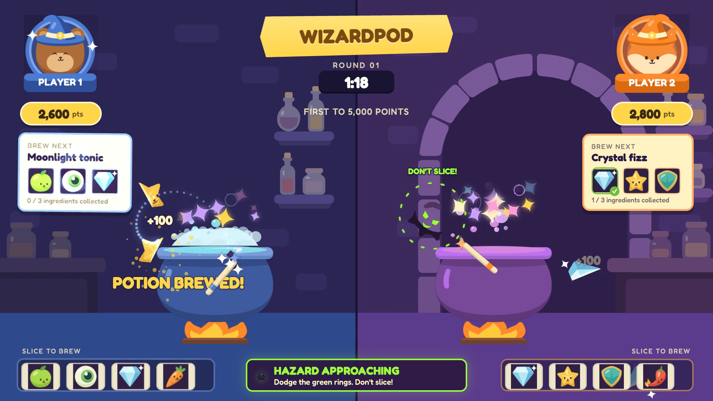
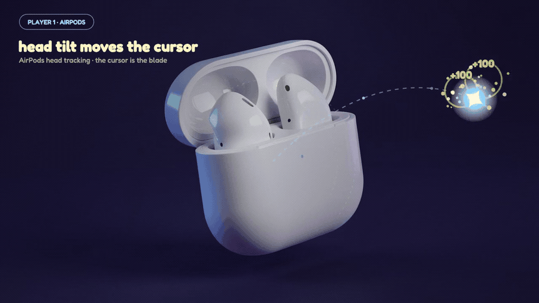
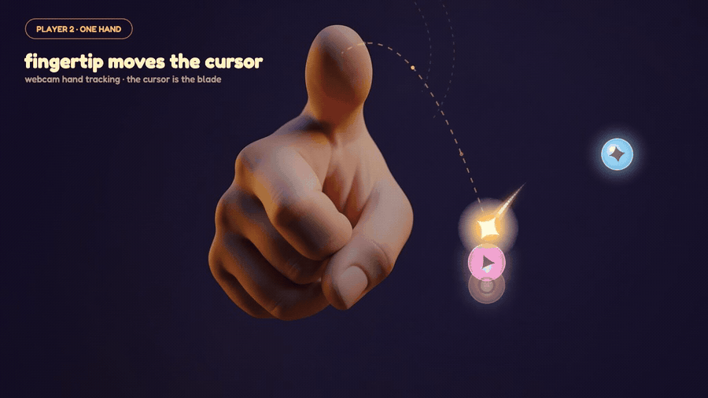
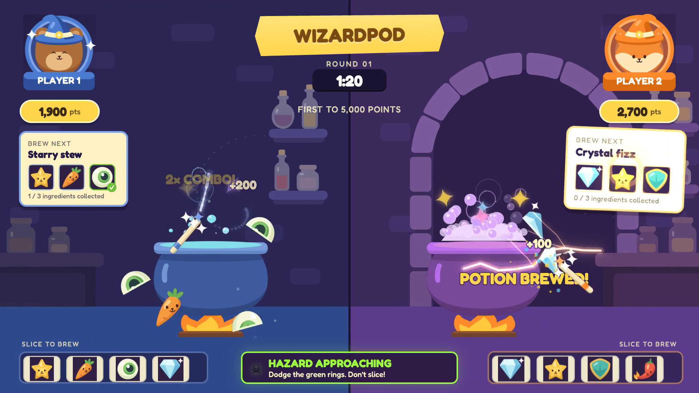
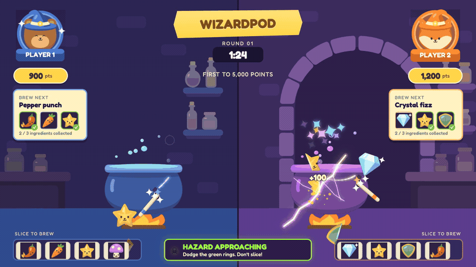

# WizardPod

A two-player wizard duel that runs in a single browser window. Ingredients are lobbed into each
half of the workshop — slice the ones your potion needs, leave everything else alone.



**Player 1** is played with AirPods: AirPointer turns head motion into the macOS cursor, so the wand
follows the pointer itself. **Player 2** holds up one hand to the webcam and the index fingertip
becomes the blade. Ninety seconds, first to 5,000 points.

## Controls

| | Player 1 (left) | Player 2 (right) |
| --- | --- | --- |
| Input | AirPods, via AirPointer moving the macOS cursor | One hand on the webcam |
| Tracked | System cursor position | Index fingertip (MediaPipe landmark 8) |
| Moves | The whole macOS cursor | Mirrored, smoothed hand position |
| Blade | Left half only | Right half only |

### AirPods → cursor



AirPointer reads head motion from the AirPods and moves the macOS cursor with it. The page only
listens for `pointermove`, so the wand, the blade and the collision point are all pinned to the real
system cursor — there is no extra bridge, button or pairing step inside the game.

### Hand → cursor



`MediaPipe HandLandmarker` runs locally on the webcam feed (the model and WASM are served from
`public/`, no CDN). The index fingertip is mirrored so moving right in the room moves right on
screen, smoothed, and squeezed into the right half of the arena.

## Gameplay





Every slice fires a different spell — lightning, runes, starburst or a spiral — coloured for the
player who cast it. Sound is synthesised live with WebAudio, including a dedicated sting for hazards
and a 138 BPM background track, so there are no audio files to load.

## Rules

- 90 seconds, first to **5,000 points**.
- Each player brews their own potion: 3 ingredients, shown on the `BREW NEXT` card.
- Recipe ingredient: **+100**. Chained slices inside 0.7 s multiply up to **×4**.
- Collect all three for a **+500** brew bonus, a fresh card and a burst of cauldron sparkles.
- Golden bonus star: **+250**, always safe to slice.
- Anything not in your recipe: **−300**.
- Spiky green-ringed orb: **−500**, and your cauldron turns toxic until you finish your next recipe.
  Dodge it — don't slice.

## Run

```bash
npm install
npm run dev
```

Open the localhost URL and press **Start**. The browser asks for camera access for player 2; the
left player works as soon as the cursor moves.

`?demo` swaps both hardware inputs for a scripted pilot (`src/demo.ts`) that chases its own recipe
and dodges hazards — handy for a screen recording on a machine with no AirPods and no camera.

## Project layout

The whole UI lives in a 1920×1080 stage that is letterboxed and scaled to the window: the HUD is
HTML/CSS in `index.html` + `src/style.css`, the arena is canvas.

| Path | What it does |
| --- | --- |
| `src/game/game.ts` | Round loop, two blades, spawning, scoring, hazards |
| `src/game/cauldron.ts` | Idle ↔ bubbling rotation, popping bubbles, success sparkles, toxic state |
| `src/game/magic.ts` | The four slice spells |
| `src/game/blade.ts` | Trail and blade/collision maths; thickness follows speed and acceleration |
| `src/game/sound.ts`, `src/game/music.ts` | WebAudio effects and the procedural soundtrack |
| `src/input/pointer.ts` | Left blade from the macOS cursor |
| `src/input/hand.ts` | Right blade from the webcam |
| `src/demo.ts` | Scripted `?demo` pilot used for the captures below |
| `public/assets/` | Figma components: avatars, cauldrons, ingredients (whole + both sliced halves), wands, hazards, workshop |
| `public/models`, `public/mediapipe` | Hand model and WASM, served locally |
| `docs/media/` | The screenshots, GIFs and the 3D control renders |
| `design/` | Reference frame exported from Figma |

Art is never redrawn: ingredients, characters, cauldrons, wands and the hazard orb are the Figma
exports, and the workshop is the frame's background layers composited into `public/assets/background.svg`.

## Media

Everything in `docs/media` is captured from this build rather than mocked up. The game is opened
with `?demo`, the scripted pilot plays for real, and the tab is recorded frame-by-frame over the
Chrome DevTools Protocol. The two control clips are 3D renders (`airpods-render.jpg`,
`hand-render.jpg`) composited in `docs/media/control-scene.html`, which draws the same pointer path,
speed-thickened trail and sliced orbs the game uses.

To reproduce:

```bash
npm run dev
open http://localhost:5173/?demo
open http://localhost:5173/docs/media/control-scene.html?device=airpods
open http://localhost:5173/docs/media/control-scene.html?device=hand
```

## Figma

The Dev Mode MCP server in Figma Desktop is reachable at `http://127.0.0.1:3845`.
`.figma/mcp.mjs` is a minimal client:

```bash
node .figma/mcp.mjs get_screenshot '{"nodeId":"13:1545"}'
node .figma/mcp.mjs get_variable_defs '{"nodeId":"13:1545"}'
node .figma/mcp.mjs get_metadata '{"nodeId":"13:1545"}'
```

Images land in `.figma/out/`. `.figma/bg/` holds the workshop layers as they were pulled, before
being assembled into the master background.
